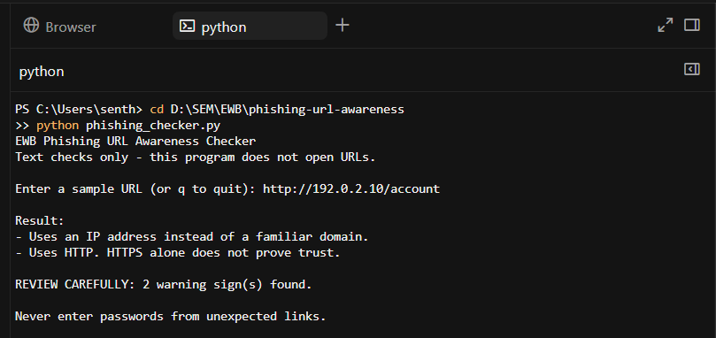
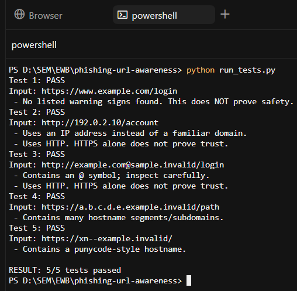
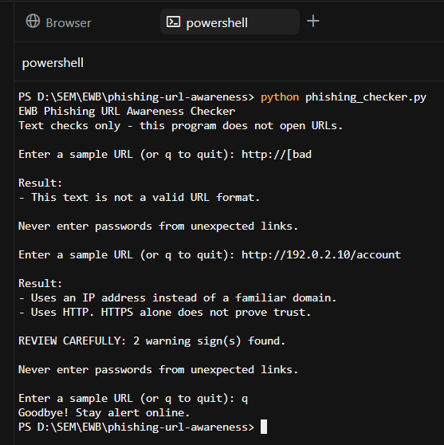

# EWB Phishing URL Awareness Checker

## Overview
Phishing is a technique used to trick people into revealing sensitive information through deceptive links or messages. This Python project checks URL text for common warning signs without visiting the website.

## Features
- Detects an @ symbol in the URL
- Flags unusually long URLs (over 100 characters)
- Flags IP-address hostnames
- Flags many hostname segments (5 or more)
- Flags punycode-style hostnames (xn--)
- Flags the HTTP scheme
- Allows multiple URL checks without restarting
- Displays a warning summary
- Handles malformed URL input

## Requirements
Python 3.10 or later. No extra packages.

## How to Run
Windows: `python phishing_checker.py`

Mac/Linux: `python3 phishing_checker.py`

## Example Output
Input: `http://192.0.2.10/account`

Result:
- Uses an IP address instead of a familiar domain.
- Uses HTTP. HTTPS alone does not prove trust.

REVIEW CAREFULLY: 2 warning sign(s) found.

## Testing
Five sample URLs were tested to check the program's detection logic.

Full results are documented in `tests/test_samples.md`.

## Screenshots

## Improvements
1. **Continuous URL checking:** Added a loop that allows users to inspect multiple URLs and quit using `q`. Tested by entering multiple samples without restarting the program.
2. **Warning summary:** Added a message displaying the number of warning signs found. Tested using the sample IP-address URL.
3. **Malformed input handling:** Added exception handling to prevent crashes on invalid URL formats. Tested with `http://[bad`.

## Limitations
This is an educational tool. It only reads URL text. It does not visit URLs, scan for malware, or prove that a URL is safe. No warning signs found does NOT mean a URL is safe.

## Ethical Use
Use sample strings only. Do not collect credentials. Do not use this project to deceive anyone or test websites without permission.

## Author
Raghul T, EWB AI Powered Cybersecurity Internship , EWB Courses